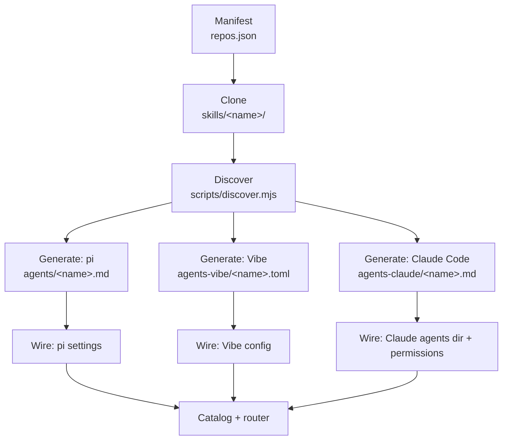

# Architecture

skill-router turns pinned third-party skill repos into isolated per-repo
agents for pi, Mistral Vibe and Claude Code, plus a catalog-driven
router. Everything is derived from one manifest; nothing is configured twice.

## Pipeline

The six stages, with the three-way branch at generate and wire
reconverging at the catalog/router:



1. **Manifest** — `repos.json`: one entry per repo with `name`, `url`,
   `description`, `persona`, and optional `skillSource` / `pathExclude` /
   `tools` curation. Validated by `loadManifest` (names, required fields, URL
   shape). An optional gitignored `repos.local.json` overlays machine-local
   entries (same validation, name collisions are a load error); overlay
   entries generate local agents but stay out of the committed catalog.
   Single source of truth — see ADR-003.
2. **Clone** — `install`/`update` clone each repo into
   `skills/<name>/` (gitignored, never committed — ADR-002). Pinned
   entries (ADR-007) clone full history and check out the pinned commit;
   `update` fetches and verifies but never moves a pin — upstream drift is
   reported, not acted on. Unpinned entries shallow-clone and pull
   `--ff-only`; a failed pull leaves the clone as-is.
3. **Discover** — `scripts/discover.mjs` walks each clone for directories
   containing `SKILL.md`, parses the frontmatter (`name`, `description`),
   applies `skillSource`/`pathExclude`, and dedupes skills by name (first
   wins, the rest are reported).
4. **Generate** — one agent per repo, restricted to that repo's skills
   (ADR-001); tools follow the per-repo policy (ADR-006): `tools: "full"`
   keeps the runtime's default tool set, anything else gets a read-only
   allowlist —
   - **pi**: `agents/<name>.md` — frontmatter `inheritSkills: false`, an
     explicit `skills:` list, `skillPath: ../skills/<name>`, and
     `tools: read, grep, find, ls` unless the entry is marked full.
   - **Vibe**: `agents-vibe/<name>.toml` — `agent_type = "subagent"`,
     `disabled_tools = ["skill"]`, `enabled_tools = ["read_file", "grep"]`
     unless full, instructions with a skill table of
     `~`-anchored `SKILL.md` paths (Vibe expanduser()s paths at runtime, so
     no machine-specific usernames are committed).
   - **Claude Code**: `agents-claude/<name>.md` — `tools: Read, Grep, Glob`,
     `omitClaudeMd: true`, persona + skill table, ownership marker.
   All three directories are committed (ADR-002). A repo with zero skills
   gets no agent; reserved or blank-description names get no Claude agent.

   One manifest entry fans out into the three generated artifacts, each
   with its own isolation mechanism:

   ```mermaid
   flowchart LR
       M["repos.json entry"] --> P["pi: agents/&lt;name&gt;.md<br/>inheritSkills: false<br/>+ read-only tools allowlist"]
       M --> V["Vibe: agents-vibe/&lt;name&gt;.toml<br/>disabled_tools: [skill]<br/>+ enabled_tools allowlist"]
       M --> CC["Claude Code: agents-claude/&lt;name&gt;.md<br/>tools: Read, Grep, Glob"]
   ```

5. **Wire settings** — idempotent, never destructive (ADR-004):
   - **pi**: `~/.pi/agent/settings.json` gains
     `subagents.agentScanDirs: ["…/skill-router/agents"]`, making the agents
     discoverable from any project. Temp-dir entries are refused and stale
     ones pruned (ADR-005).
   - **Vibe**: `~/.vibe/config.toml` (or `$VIBE_HOME`) gains the
     `agents-vibe/` dir in `agent_paths` and `[tools.read_file]` allowlist
     patterns — one per depth (`skills/*` … `skills/*`×8), because Vibe's
     component-strict pathlib matching makes a single `skills/**` match
     nothing.
   - **Claude Code**: the installer copies owned agent files into
     `~/.claude/agents/`, installs the `route-skill` skill, and merges two
     `permissions.allow` `Read` rules (this checkout's `skills/**` and
     `catalog/**`) into `~/.claude/settings.json` with a `.bak` copy.
   All writes are atomic with a `.bak` backup; forms the merger cannot
   merge safely are skipped and the exact manual remedy is printed.
6. **Catalog + router** — `catalog/skill-catalog.md` (one bullet per skill,
   rebuilt every run) and a generated `skill-router` agent on every target:
   pi and Claude Code reach it through the global `route-skill` skill; Vibe
   discovers it by its `description` (its discoverability is mechanically
   confirmed but not yet probe-verified — re-check after Vibe upgrades).
   The router reads the catalog, opens the winning
   `SKILL.md`, and returns the skill name, path, why it fits, and a digest —
   the catalog's bulk never enters the calling session's context. All are
   derived artifacts, regenerated on every run; `status` reports them, and
   CI fails the build if the committed ones drift from what the generator
   produces.

Renaming or removing a manifest entry prunes its agent files and clone on
the next run; pruning only deletes files that look generated.

## Code layout

`scripts/generate.mjs` is the entry point and re-exports everything, so
`scripts/test.mjs` and `install.sh` (a one-line `exec node` wrapper) use it
unchanged. Imports only point down this list, keeping the graph acyclic:

- `scripts/common.mjs` — shared helpers (paths, text normalising,
  `atomicWrite`, status constants, the router body).
- `scripts/discover.mjs` — finding and parsing skills in a clone.
- `scripts/claude.mjs` — the Claude Code target (rendering, ownership,
  installer, permissions merge, skills sync, install status).
- `scripts/generate.mjs` — manifest, pi and Vibe targets, catalog, prune,
  status, install flow and CLI.

## Commands

```sh
./install.sh install   # clone, generate, wire settings
./install.sh update    # pull clones, regenerate, report skill deltas
./install.sh status     # read-only health table; non-zero when out of sync
node scripts/test.mjs   # offline, fixture-based; no network needed
```

## Decisions

- [ADR-001](decisions/ADR-001-one-clean-room-agent-per-repo.md) — one
  clean-room agent per repo
- [ADR-002](decisions/ADR-002-generated-agents-committed-clones-gitignored.md)
  — generated agents committed, clones gitignored
- [ADR-003](decisions/ADR-003-repos-json-single-source-of-truth.md) —
  `repos.json` as the single source of truth
- [ADR-004](decisions/ADR-004-never-write-user-config-destructively.md) —
  never write user config destructively
- [ADR-005](decisions/ADR-005-refuse-temp-dir-entries-in-persistent-settings.md)
  — refuse temp-dir entries in persistent pi settings
- [ADR-006](decisions/ADR-006-per-repo-tool-policy-for-generated-agents.md)
  — per-repo tool policy for generated agents
- [ADR-007](decisions/ADR-007-sha-pinning-over-dry-run.md) — SHA pinning
  over `--dry-run`
- [ADR-008](decisions/ADR-008-anchor-flag-for-committed-generation.md)
  — `--anchor` flag for committed-file generation
- [ADR-009](decisions/ADR-009-workflows-internal-seam.md) — workflows
  as an internal seam with a named split trigger
- [ADR-010](decisions/ADR-010-vibe-orchestrator-mode.md) — the Vibe
  workflow runner as a generated mode TOML
- [ADR-011](decisions/ADR-011-extract-workflows-to-skill-workflows.md) —
  extract the workflows module to skill-workflows
- [ADR-012](decisions/ADR-012-vibe-router-and-harness-facts.md) — Vibe
  router agent and the source-verified Vibe harness facts
